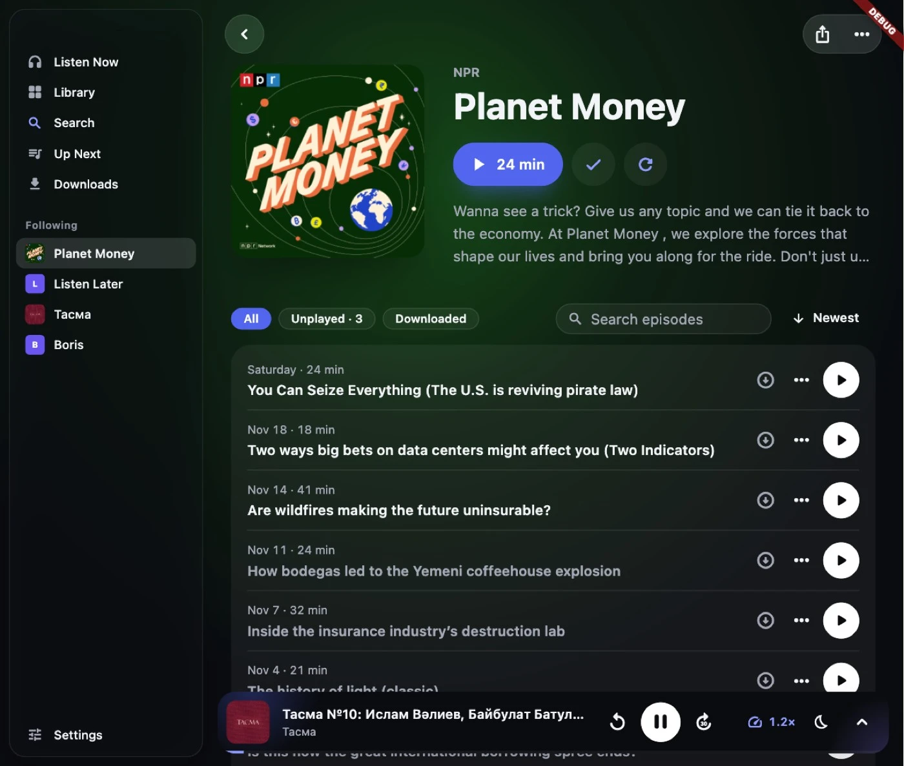

# Listenjar

A podcast player for Mac, Windows, Linux, Android, iPhone and iPad, from [listenjar.com](https://listenjar.com).
Free, and you don't need an account.

## Get it

- **Mac, Windows, Linux and Android:** download it from the [latest release](https://github.com/listenjar/app/releases/latest).
  - Mac: the `.dmg`.
  - Windows: the `x64` installer for most PCs, the `arm64` one for Windows on Arm.
  - Linux: the `.tar.gz`. It needs mpv's library to play: `libmpv2` on Debian and Ubuntu,
    `mpv-libs` on Fedora, `mpv` on Arch.
  - Android: the `arm64-v8a` APK for most phones.
- **iPhone and iPad:** join the beta on [TestFlight](https://testflight.apple.com/join/HHHDHV2a).

On Mac, Windows and Android the app updates itself; on iPhone and iPad, TestFlight does.

## What it does

- **Any podcast.** Search Apple's podcast directory and its charts, or paste a show's RSS link.
  Bring your shows over from another app with an OPML file, and take them with you the same way.
- **Your shows at a glance.** Each show's page leads with its artwork, lit by its own colours,
  and on a computer the shows you follow sit in the sidebar, a click away.
- **Listening.** Up Next, playback speed, a sleep timer, and skipping back and forward. Your
  keyboard's media keys, your headphones' buttons and the lock screen control it too.
- **Downloads.** Download episodes to listen offline. See which shows take the most space, cap
  downloads at a size you pick, and have finished episodes deleted on their own.
- **YouTube videos as episodes.** Paste a YouTube video's link and it plays like any episode.
- **Share to it.** Share a YouTube or podcast link to Listenjar from another app and it opens
  there. On Android, turn on "Open supported links" in the app's settings for YouTube links to
  open in Listenjar.

## Listenjar Cloud

Sign in to turn YouTube playlists and channels, or any videos you gather, into podcasts of your
own. Listenjar hosts them as podcast feeds, so new episodes reach the app and any other podcast
app you use. The [paid plans](https://listenjar.com) pay for their storage.

## Privacy

The app fetches each show's feed and episodes from the show's own host, searches Apple's podcast
directory and YouTube, and talks to Listenjar only when you're signed in. Nothing else: no
tracking, analytics or crash reports.

## For developers

How to build, run and release it is in [DEVELOPMENT.md](DEVELOPMENT.md). The app is open source
under the [MIT License](LICENSE).
